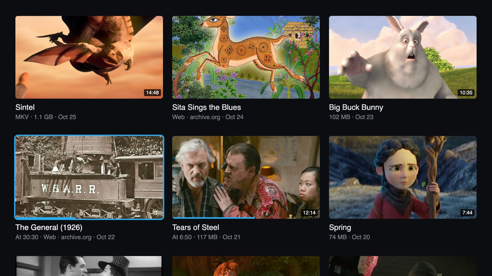
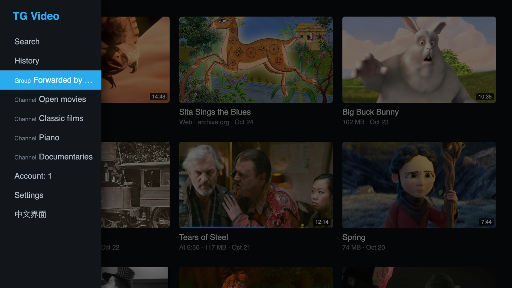
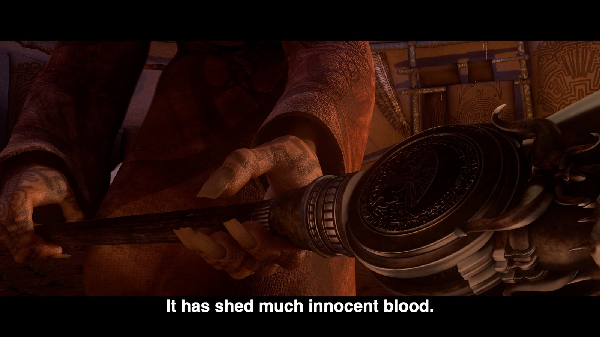
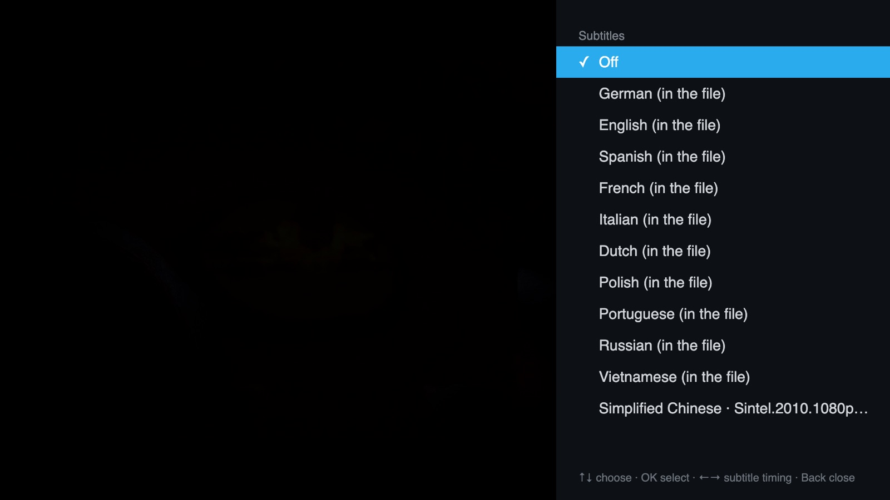
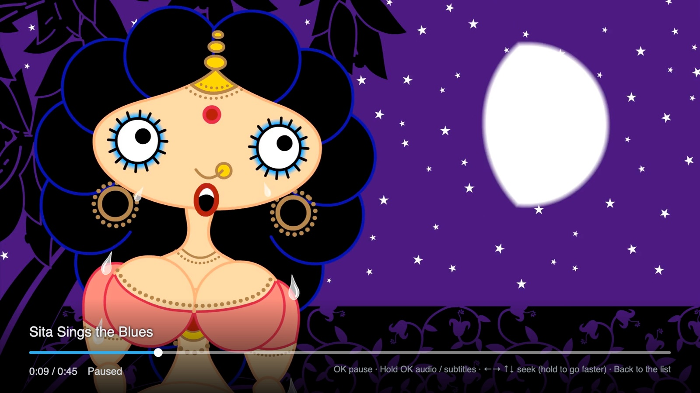
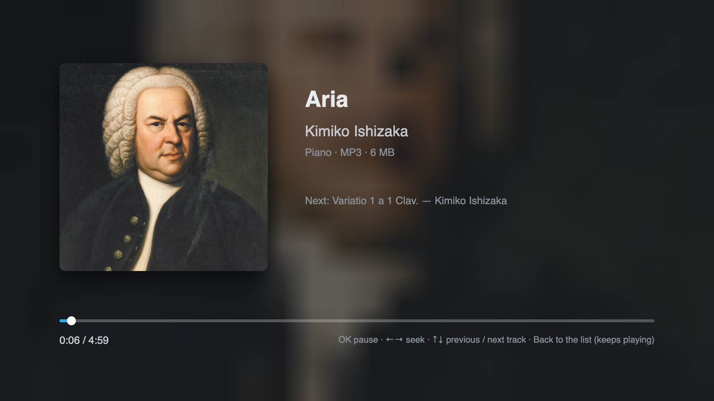
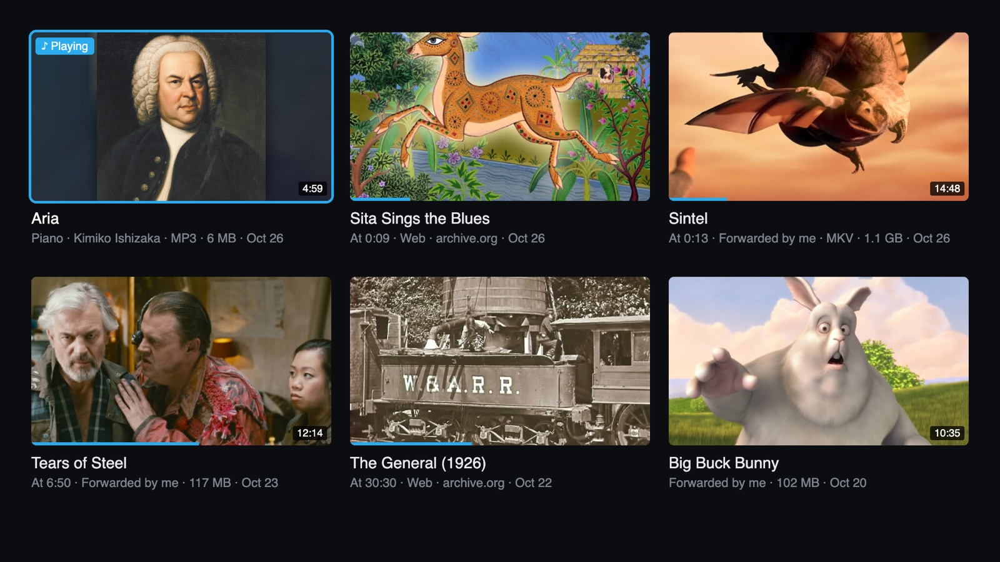

# Telegram videos on a Samsung TV

**English · [中文](README.zh.md)**

A player for the videos in your Telegram groups and channels, on Samsung Tizen TVs. Sign in by scanning a QR
code with your phone; the groups and channels that contain videos are on the left, a grid of their videos on the
right, and the remote plays them. It streams while it downloads, so a multi-gigabyte film starts in seconds and
you can seek anywhere. The TV talks to Telegram directly: **there is no server, and your session never leaves
the set.**

The everyday use it was built for: find a film on your phone, forward it to a group of your own, and play it on
the TV. Everything Telegram can play on a phone — MP4s sent as videos, MKVs and MP4s sent as files, links to
`.m3u8` streams — plays here. **It is not screen mirroring:** the TV fetches the original file itself, so you get
the original picture quality, and your phone is free as soon as the message is sent.

> **The interface is in English or Chinese.** It follows the TV's system language — Chinese if the TV is set to
> Chinese, English otherwise — and the last entry of the source list switches it.

> **Not affiliated with Telegram or Samsung.** A personal project, MIT licence.
> Sister projects: [bilibili-tizen](https://github.com/titlog/bilibili-tizen),
> [douyin-tizen](https://github.com/titlog/douyin-tizen).



*Videos and web links forwarded to one group, three to a row; ones you have started show a progress bar.*

| | |
|---|---|
|  |  |
| Press Left to slide out the source list: the groups and channels that have videos | A 1.1 GB MKV sent as a file, streaming, with its English subtitle track on |
|  |  |
| Hold OK: the ten subtitle tracks inside the file, plus a subtitle file posted in the group | An archive.org film page posted in the group: the TV looks up the 1080p original and plays it |
|  |  |
| Songs posted in a channel: pick one and the rest play in order; Back returns to the list while it keeps playing | History: everything you've played, most recent first, with where it came from and how far you got |

> The group names, dates and file sizes in the screenshots are made up (`test/readme-shots.mjs` replaces the
> Telegram layer), and the players show a short excerpt. Every film can be shared legally: Blender open movies —
> [Sintel](https://durian.blender.org/) (its official MKV release and subtitles), Big Buck Bunny, Tears of Steel, Spring,
> Sprite Fright, Charge, Elephants Dream, Coffee Run and Caminandes 3, © Blender Foundation / Blender Studio,
> CC BY 2.5–4.0 — and from [archive.org](https://archive.org/), Sita Sings the Blues (Nina Paley, 2008, CC0),
> The General (Buster Keaton, 1926) and His Girl Friday (Howard Hawks, 1940), the last two public domain in the US.
> Covers are frames from the films; sources and licences per film are in `test/readme-shots.mjs`. The music is
> [The Open Goldberg Variations](https://archive.org/details/OpenGoldbergVariations) (Kimiko Ishizaka, 2012, CC0), with
> Haussmann's 1748 portrait of Bach (public domain) as the cover.

## What it does

- **QR sign-in** with [mtcute](https://github.com/mtcute/mtcute), which runs in a worker so the interface never
  stutters while data arrives. The session survives reinstalling the app. Two-step verification passwords are
  supported.
- **Source list** of only the chats that actually contain videos. It opens straight into the chat you used last and
  remembers how far you got in every video.
- **Hand-written MP4 and MKV parsers feeding Media Source Extensions.** Measured on the TV: a 2.6 GB, 3 h 39 min
  film shows its first frame in 5.8 s, and a jump to a part that is not downloaded yet plays in 0.6 s. Files whose
  audio and video are stored far apart (some 4K releases) are read along two paths so resuming does not have to
  download hundreds of megabytes first.
- **Videos sent as files show up too** — most MKVs are posted that way, and Telegram's own "videos" filter does not
  list them. MKV/WebM support: H.264, HEVC, VP9 and AV1 video; AAC, AC-3, E-AC-3, Opus and FLAC
  audio. These TVs cannot decode DTS or TrueHD; when a file has another audio track the player switches to it,
  otherwise it plays without sound and says so.
- **Audio tracks and subtitles.** Hold OK while a video plays to open a menu: switch audio tracks (dubs, original,
  commentary), turn subtitles on, or shift their timing in 0.5 s steps. Subtitles can come from inside the file
  (mov_text in MP4; SRT, ASS and PGS image subtitles in MKV) or from an `.srt` / `.ass` / `.vtt` file posted in
  the same group — it matches the file to the video by name and posting time, and detects UTF-8, UTF-16, GBK and
  Big5. Your choice is remembered per video.
- **Series play the next episode** when one ends, with an 8-second countdown. Episode numbers are read from the
  title or file name: `S01E03`, `EP03`, `E03`, `[03]`, `Show - 03`, and Chinese `第3集`.
- **Search** every group and channel you are in, from the top of the source list — titles, captions and file
  names. Recent searches are kept, since typing with a remote is slow.
- **History**, the second entry in the source list: the videos, web links and songs you've played, most recent first,
  with the group each came from and how far you got. Each account keeps its own (up to 200); Settings can clear it.
- **Music**: songs posted in your groups and channels (MP3, M4A, OGG / Opus, WAV and FLAC) sit in the grid alongside
  the videos, and channels with only songs appear in the source list too. Pick one and the rest play in order; Up / Down
  change track, and Back returns to the list while the music keeps playing. These TVs cannot decode FLAC themselves, so
  the app decodes it while downloading. Music stops when you leave the app.
- **Covers**: when the thumbnail is a black first frame (common with large files), a frame from the middle of the
  film is decoded instead; films get a poster from Wikipedia.
- **Web links**: `.m3u8` and `.mp4` links posted in a group play directly, and so do **archive.org film pages** —
  the one site rule the repository ships (`app/js/sites.js`) asks archive.org's public API for the item's files and
  picks the sharpest MP4, up to 1080p. Other sites need a site rule, which you write yourself in
  `app/js/sites.local.js` (it is not in the repository); the format is at the top of [`app/js/web.js`](app/js/web.js).
  Services with DRM cannot be played, and YouTube is not attempted.
- Switch to another app and back, and it reconnects on its own.
- **Several accounts on one TV**: the Account entry in the source list adds accounts (by QR code), switches between
  them without scanning again, and signs them out. Everyone's sources and progress are kept separately.
- **Self-update** (from 1.1.0): a newer signed version is downloaded in the background while the app is open and runs
  from the next launch, with an "Updated to x.y.z" notice.
- **Diagnostic logs** (from 1.1.0): when something goes wrong, the app sends the developer the information needed to
  find out why, and nothing that identifies you. It can be switched off under Settings in the source list. Error
  screens and Settings show a QR code that opens a new GitHub issue with the TV's code already filled in, so the
  report and the logs can be matched.

Subtitles turn on by themselves only when the dialogue is not in the interface language **and** a subtitle track or
file in that language exists — with the English interface, an English subtitle for a film in another language;
otherwise they start off and the menu has them. Captions written the way Chinese channels do, `《Title》`, use the
part inside the brackets as the title.

## The remote

| Where | Button | Does |
|---|---|---|
| Grid | arrows, OK | move, play |
| Grid | Left on the first column | open the source list (Search and History are at the top; Account and the language switch are at the bottom) |
| Grid | Back, twice | quit |
| Player | OK, or Play/Pause | pause / resume |
| Player | **hold OK** (about 1 s) | menu: audio track, subtitles, subtitle timing, next episode |
| Player | Left / Right | −/+ 15 s; keep holding and the steps grow to 30 s, 1 min, 2 min, 5 min |
| Player | Up / Down, or Fast-forward / Rewind | +/− 1 min; holding grows to 2, 5, 10, 15 min |
| Player | Back | back to the grid (your position is saved) |
| Source list | Account | switch accounts, add one, or sign the current one out (press OK twice) |

Seeks are applied 0.7 s after you stop pressing, so you can press several times and only download once.

## Things to try

All of these can be shared legally, and between them they exercise the main features:

- **MKV, many subtitle tracks, a subtitle file**: Blender's official
  [`Sintel.2010.1080p.mkv`](https://download.blender.org/durian/movies/) (1.1 GB, H.264 1080p + AC-3 5.1 + ten subtitle
  tracks), sent to your group as a file. Subtitles in more languages are at
  [download.blender.org/durian/subs](https://download.blender.org/durian/subs/); name one like the film
  (`Sintel.2010.1080p.chs.srt`) and post it in the same group, and the TV pairs them.
- **Web links**: post archive.org film pages in the group, for example
  `https://archive.org/details/Sita_Sings_the_Blues` (1080p animation), `https://archive.org/details/TheGeneral1926`,
  `https://archive.org/details/his_girl_friday`. Its [Feature Films](https://archive.org/details/feature_films)
  collection has many more — post the page of a single film; the collection page itself is not recognised. Some
  uploads there claim to be public domain when they are not, so check before you share.
- **Music**: the MP3s of [The Open Goldberg Variations](https://archive.org/details/OpenGoldbergVariations) (Bach played
  by Kimiko Ishizaka, CC0), posted to a channel or group.

## Will it run on my TV

| | |
|---|---|
| **Tested** | Samsung 2023 65" **CU7090**, firmware Tizen 9.0 (Chromium 120) |
| **Minimum** | Tizen 5.0 (roughly 2019 models onwards). On Tizen 5.0 the app uses a separate build of the Telegram client library, because that browser lacks BigInt (big numbers are done in plain JavaScript instead); it hasn't been tried on a real 5.0 TV yet, and the first sign-in is slower. Tizen 4.0 and older can't install it |
| **Other models** | Untested. Whether it works or not, please open an issue with your model and firmware version (Settings → Support → About This TV) |

Download speed is Telegram's, not your connection's: without Premium the TV measured a steady 1.7–2.3 MB/s, about
ten times the bitrate of the 1080p film it was measured with. High-bitrate 4K remuxes can be faster than that and will pause to
buffer. The TV connects to Telegram over WebSocket (`*.web.telegram.org`); there is no proxy setting.

## Install

Samsung's store does not accept third-party clients, so this is sideloaded. **It only has to be done once**; after
that the app opens from the TV like any other. Two ways:

| | Release package (recommended) | From source |
|---|---|---|
| For | just watching on the TV | changing the code, reading the diagnostic logs |
| Needs | a computer (Windows / macOS / Linux) **or an Android phone** with [Apps2Samsung](https://github.com/Apps2Samsung/Apps2Samsung) | macOS, Node, the Tizen Studio command-line tools, and a Telegram API ID of your own |
| Updating | **updates itself from 1.1.0**; on 1.0.0 install it once more with Apps2Samsung (the sign-in and watch history are kept) | `git pull`, then `deploy.sh` again |

**Both start with this:** enable Developer Mode on the TV — on the Apps screen type `12345` on the remote, switch it on,
set Host PC IP to the computer or phone you install from — then **power-cycle the set** (unplug it).

Both ways also need a Samsung account (free to create): the first install asks you to sign in, to get this TV
a certificate, and that is all.

### Release package

1. Install [Apps2Samsung](https://github.com/Apps2Samsung/Apps2Samsung/releases) (desktop or Android).
2. Open it and pick your TV (or type its IP).
3. Find **Telegram Videos** in its app list (the community catalog) and install it. The first time it asks you to sign
   in to a Samsung account so it can get a certificate for this TV.
4. Open "TG Video" on the TV; on your phone open Telegram → **Settings → Devices → Link Desktop Device** and scan the code.

The catalog picks up the latest release from here once a day. For a version it has not picked up yet, or a specific
one, download `telegram-tizen-<version>.wgt` from [Releases](https://github.com/titlog/telegram-tizen/releases/latest)
and choose a custom `.wgt` in step 3 instead.

The release package ships with this project's Telegram API ID, so it signs in straight away. Should Telegram ever stop
accepting it, the app asks for one of your own from [my.telegram.org](https://my.telegram.org) (the TV shows a code that
opens it), once.

**Only an iPhone?** Apps2Samsung has no iOS version; sideloading takes a computer or an Android phone. It is needed once
(after that the TV installs new versions itself), so borrowing a computer for the install is enough.

### From source

You need **macOS**, Node, and the [Tizen Studio](https://developer.tizen.org/development/tizen-studio/download)
command-line tools (not the IDE).

1. **TV, developer mode and the Samsung certificate.** These are shared with
   [bilibili-tizen](https://github.com/titlog/bilibili-tizen) — the same TV and certificate work for both. Follow its
   [From source](https://github.com/titlog/bilibili-tizen/blob/master/README.en.md#from-source) section once: enable
   Developer Mode on the TV (on the Apps screen type `12345`, switch it on, set Host PC IP to your computer, then
   power-cycle the set), and run its `zsh tools/setup.sh`, which finds the TV, reads its DUID and obtains the
   Samsung-issued certificate (2023+ sets reject the certificates that come with Tizen Studio). The settings end up
   in `~/.bilibili-tizen.conf`, which this project reads.
2. **Your Telegram API ID.** Create an application at [my.telegram.org](https://my.telegram.org) → API development
   tools, and put the two values in `~/.telegram-tizen.conf`:
   ```bash
   TG_API_ID=1234567
   TG_API_HASH=0123456789abcdef0123456789abcdef
   ```
   They are written into your package only while it is being built and put back to empty values in the source
   straight after, so they never end up in the repository.
3. **Build and install:**
   ```bash
   git clone https://github.com/titlog/telegram-tizen.git && cd telegram-tizen
   zsh tools/deploy.sh          # bundles mtcute, signs, installs and launches
   ```
4. On the TV, open Telegram on your phone → **Settings → Devices → Link Desktop Device**, and scan the code.

To update: `git pull`, then run `deploy.sh` again. Your session and watch history are kept.

> **Don't switch between the two.** They are signed with different certificates, and the TV will not let a package
> signed with one replace the same app signed with the other. To switch, delete the old one on the TV first — which
> clears the sign-in and watch history.

## Accounts and privacy

- You sign in by QR code; the session is stored in the TV's IndexedDB and goes through no other server. Each account
  has its own database. Switching accounts needs no password — anyone holding the remote can switch. Signing an
  account out ends that session on Telegram's side and deletes that person's records from the TV.
- The release package ships with this project's API ID and hash; built from source, it uses your own, which only go into
  your own package. One entered on the TV (if the built-in one stops working) is stored on the TV only.
- Built from source, the app sends diagnostic logs just like the release package (from 1.1.4), and they can be
  switched off in Settings; or add the line `TG_DIAG_TO=off` to `~/.telegram-tizen.conf` and builds from that
  computer send nothing.
- Web sign-in (some site lists need it): the password is not stored or logged; only the account number the site
  returns is kept.

## Debugging and tests

```bash
node tools/collect.mjs       # terminal 1: receives the TV's logs on port 8097
zsh tools/deploy.sh          # terminal 2
```

Web Inspector does not open on retail sets, so the app reports what it does to the collector — start-up times,
codecs, track lists, every seek and stall.

Desktop tests live in `test/` and need Playwright and ffmpeg; the test files are generated with ffmpeg (and
mkvtoolnix for the MKV set), with the commands at the top of each script:

| | |
|---|---|
| `check.mjs` | MP4 parser against ffprobe; the rebuilt fragments decoded by ffmpeg |
| `check-mkv.mjs` | MKV parser frame by frame against ffprobe, including lacing, header stripping, missing Cues |
| `check-subs.mjs` | subtitle encodings and formats; PGS rendering compared pixel by pixel with ffmpeg |
| `check-flac.mjs` | the FLAC decoder, byte for byte against ffmpeg |
| `legacy-bigint.mjs` | the big-number code of the Tizen 5.0 build, against native BigInt |
| `i18n.mjs` | every interface string has an English translation |
| `apikey.mjs` | where the API ID comes from, and the screen for entering one |
| `run.mjs` | the playback engine in Chromium over a throttled server that imitates Telegram |
| `ui-emu.mjs` | the whole interface with fake data, driven by key presses, with screenshots (`UILANG=en` for English) |
| `readme-shots.mjs` | retakes the screenshots above (`UILANG=en` for these, without it the Chinese set) |

Conclusions and how to debug are in [`CLAUDE.md`](CLAUDE.md); the story behind each one, with measurements, is in
[`docs/`](docs/) by topic (both in Chinese).

## Layout

```
app/              the client (no build step; mtcute is bundled into js/tg.bundle.js, and js/tg.legacy.js for Tizen 5.0, by deploy.sh)
  js/app.js         screens and remote keys: sign-in, grid, player, menu, next episode, search
  js/i18n.js        interface language: English / Chinese
  js/accounts.js    several accounts: one session database each, per-person local records
  js/apikey.js      which Telegram API ID to use: the one the package ships with, or one entered on the TV
  js/boot.js        which code this launch runs: the package's, or a newer signed version downloaded by the self-update
  js/update.js      self-update: check, download, verify the signature
  js/diag.js        diagnostic logs: an identity-scrubbed ring, sent to the developer when something goes wrong or by hand
  js/tg.js          the Telegram layer: chats, videos (sent as videos and as files), search, subtitle files
  js/player.js      MSE playback engine
  js/mp4.js         progressive MP4 → fragmented MP4
  js/mkv.js         MKV / WebM demuxer → fragmented MP4
  js/subs.js        subtitles: files, embedded text, PGS, rendering
  js/cover.js       covers: a decoded frame, Wikipedia posters
  js/music.js       music: download the whole track and play it, queue, prefetch the next one
  js/flac.js        FLAC software decoder (these TVs can't decode FLAC)
  js/web.js         web links (the framework)
  js/sites.js       the site rule the repository ships: archive.org (your own go in sites.local.js, not in the repository)
build/            mtcute's bundle entry points (worker and main thread); legacy/ is the build for TVs without BigInt
spike/            feasibility probes and engine measurements, not packaged
test/             desktop tests
tools/            deploy, release package (release.sh), self-update (update-*.mjs), log collector
update/           the self-update's signed manifest and bundle
CLAUDE.md         conclusions, rules, and how to debug on a retail set
docs/             the story and measurements behind each finding, by topic; README screenshots
```

## Licence

MIT. `app/js/vendor/hls.min.js` (hls.js) is Apache-2.0; mtcute, qrcode-generator and bn.js, bundled at build time, are
MIT, and JSBI (in the Tizen 5.0 build) is Apache-2.0. See [THIRD_PARTY_NOTICES.md](THIRD_PARTY_NOTICES.md). Telegram is a trademark of its owner; this project is not
affiliated with it.
