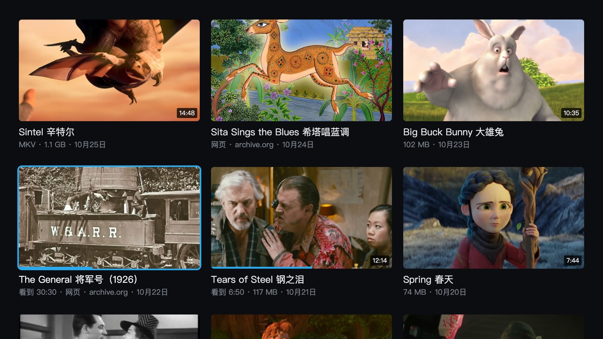
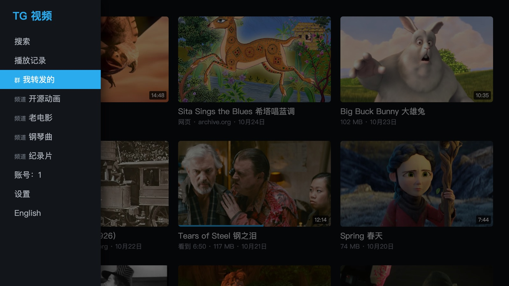
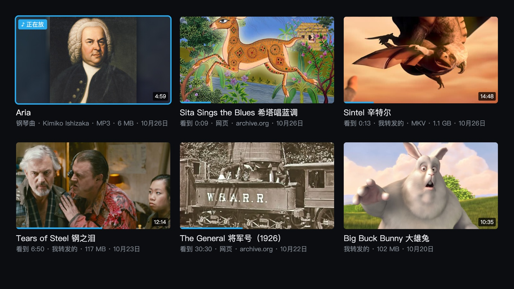

# 三星电视上放 Telegram 里的视频

**[English](README.md) · 中文**

给三星 Tizen 电视做的 Telegram 视频播放器：扫码登录，左边是有视频的群和频道，右边是视频网格，遥控器选了就放。
边下边播，几个 GB 的长片也是几秒出画面、随便跳。电视直连 Telegram：**没有服务器，会话只存在电视本机。**

平常这么用：手机上看到想看的片子，转发进一个群（自己建一个只有自己的群就行），电视上点开就放。**这不是投屏**：
电视自己去拿原片，原片多清楚电视上就多清楚；手机发完就能放下，不用一直开着。

> **与 Telegram、三星均无关联。** 个人项目，MIT 协议。
> 兄弟项目：[bilibili-tizen](https://github.com/titlog/bilibili-tizen)、[douyin-tizen](https://github.com/titlog/douyin-tizen)。



*一个群里转发的视频和网页链接混在一起，三列；看过的带进度条。*

| | |
|---|---|
|  |  |
| 按左键滑出来源栏：有视频的群和频道 | 当文件发的 1.1GB MKV，边下边播；中文字幕是和片子发在同一个群里的 `.srt`（GBK 编码） |
|  |  |
| 长按确认键：片子里带的 10 条字幕，加上群里的字幕文件 | 群里发的 archive.org 片子页链接：电视自己问出 1080p 原片来放 |
|  |  |
| 频道里发的歌：点一首就按顺序放下去，按返回回到列表接着放 | 播放记录：放过的都在这，最近的在前，写着来自哪个群、看到哪里 |

> 截图里的群名、日期和文件大小是编的（`test/readme-shots.mjs` 换掉了 Telegram 层），播放的是从片子里截的一段。片子都能合法转发：
> Blender 的开源电影 [Sintel](https://durian.blender.org/)（官方发布的 MKV 和中文字幕）、Big Buck Bunny、Tears of Steel、Spring、
> Sprite Fright、Charge、Elephants Dream、Coffee Run、Caminandes 3，© Blender Foundation / Blender Studio，CC BY（2.5–4.0）；
> [archive.org](https://archive.org/) 上的 Sita Sings the Blues（Nina Paley，2008，CC0）、The General（Buster Keaton，1926）、
> His Girl Friday（Howard Hawks，1940），后两部在美国是公有领域。封面是片中的画面，各片的出处和协议见 `test/readme-shots.mjs`。
> 音乐是 [The Open Goldberg Variations](https://archive.org/details/OpenGoldbergVariations)（Kimiko Ishizaka 弹的巴赫，2012，CC0），
> 专辑图是 Haussmann 1748 年画的巴赫像（公有领域）。

## 能做的

- **扫码登录**（[mtcute](https://github.com/mtcute/mtcute)，客户端跑在后台线程，界面不卡），会话活得过重新安装。
- **来源栏**只列有视频的群和频道；视频网格三列，记得每部看到哪里，开机直接进上次的来源。
- **自己写的 MP4 / MKV 解析 + MSE 边下边播**：2.6GB 的电影 5.8 秒出画面，跳到没缓冲的地方 0.6 秒；
  音视频在文件里隔得很远的片子分两路读。当文件发的视频（MKV、不压缩发的 MP4）也在网格里。
  MKV 支持 H.264 / HEVC / VP9 / AV1，AAC / AC-3 / E-AC-3 / Opus / FLAC（DTS、TrueHD 电视放不了）。
- **多音轨、字幕**：播放时长按确认键开菜单，换音轨（国语 / 粤语 / 原声）、开字幕、调字幕时间。
  字幕可以是片子里带的（MP4 的 mov_text，MKV 的 SRT / ASS / PGS 图形字幕），也可以是和片子发在同一个群里的
  `.srt` / `.ass` 文件（GBK、Big5 编码也认）。对白不是中文时自动开中文字幕。
- **连续剧自动放下一集**（认「第 3 集」「S01E03」「EP03」「[03]」），放完倒计时 8 秒。
- **搜索**：来源栏最上面，在所有群和频道里找视频和歌（片名、说明文字、文件名）。
- **播放记录**：来源栏第二项，放过的视频、网页链接和歌，最近的在前，卡片上写着来自哪个群、看到哪里。每个账号各记各的，最多 200 条；设置里可以清空。
- **音乐**：群和频道里的歌（MP3、M4A、OGG / Opus、WAV、FLAC）和视频混在网格里，只有歌的频道也在来源栏里。点一首就按顺序一首首放下去，
  ↑↓ 换歌；按返回回到列表时接着放。FLAC 电视自己解不了，应用里自己解（边下边解）。离开应用就停。
- **封面**：缩略图太黑就从片子中间解一帧，电影去维基百科找海报。
- **网页链接**：群里发的 `.m3u8` / `.mp4` 链接直接放；**archive.org 的片子页链接**也认 —— 这是仓库里带的唯一一条站点规则
  （`app/js/sites.js`），问 archive.org 的公开接口，挑最清楚的那份 MP4（最高 1080p）。别的网站要自己写一条规则，写在
  `app/js/sites.local.js` 里（不进仓库），格式见 [`app/js/web.js`](app/js/web.js) 开头。有 DRM 的正版平台放不了，YouTube 也不做。
- 切到别的应用再回来，自动重连。
- **一台电视好几个账号**：来源栏里的「账号」可以添加（扫码）、切换（不用重新扫码）、退出。每个人的来源、看到哪里各记各的。
- **中英双语界面**：跟电视的系统语言走（系统是中文就中文，别的都英文），来源栏最下面可以切换。
- **自动更新**（1.1.0 起）：开着应用时查到新版本就在后台下载，下次打开生效，屏幕上提示「已更新到 x.y.z」。
- **诊断日志**（1.1.0 起）：出问题时，应用会收集一些排查必要的运行信息传给开发者，不会泄露个人隐私。来源栏的「设置」里可以关掉；
  报问题时附上那里显示的这台电视的编号。

## 拿什么试

下面这些都能合法转发，顺带把几样主要功能走一遍：

- **MKV、多条字幕、外挂中文字幕**：Blender 官方的 [`Sintel.2010.1080p.mkv`](https://download.blender.org/durian/movies/)
  （1.1GB，H.264 1080p + AC-3 5.1 + 10 条内嵌字幕）和中文字幕 [`sintel_chs.srt`](https://download.blender.org/durian/subs/)，
  当文件发进你的群。字幕文件改成和片子同名（`Sintel.2010.1080p.chs.srt`），电视会自动配上。
- **网页链接**：把 archive.org 的片子页链接发进群，比如 `https://archive.org/details/Sita_Sings_the_Blues`（1080p 动画）、
  `https://archive.org/details/TheGeneral1926`、`https://archive.org/details/his_girl_friday`。它的
  [Feature Films](https://archive.org/details/feature_films) 合集里还有很多老电影 —— 要发单部片子的链接，合集页本身不认；
  合集里也有上传者自称公有领域、其实不是的，转发前看一眼。
- **音乐**：[The Open Goldberg Variations](https://archive.org/details/OpenGoldbergVariations)（Kimiko Ishizaka 弹的巴赫《哥德堡变奏曲》，CC0）
  的 MP3，发进一个频道或群。

## 我的电视能装吗

| | |
|---|---|
| **实测可用** | 三星 2023 年款 65 吋 **CU7090**，固件 Tizen 9.0（Chromium 120） |
| **最低要求** | Tizen 5.0（大致是 2019 年款起）。Tizen 5.0 上用的是专门打的一份 Telegram 客户端库（那代浏览器没有 BigInt，大数换成了纯 JS 实现），还没在真的 5.0 电视上试过，第一次登录会慢一些。4.0 及更早的装不上 |
| **其他机型** | 没人试过。装成功或者失败，都欢迎开 issue 说一声机型和固件版本（设置 → 支持 → 关于本电视） |

## 安装

三星商店不收第三方客户端，只能侧载。**只需要一次**，之后电视上直接开。两条路：

| | 装发布包（推荐） | 从源码装 |
|---|---|---|
| 适合 | 只想在电视上看 | 要改代码、要看诊断日志 |
| 需要 | 电脑（Windows / macOS / Linux）**或安卓手机**，装上 [Apps2Samsung](https://github.com/Apps2Samsung/Apps2Samsung) | macOS、Node、Tizen Studio 命令行工具，以及你自己申请的 Telegram API ID |
| 升级 | **1.1.0 起自动更新**；1.0.0 要用 Apps2Samsung 再装一次（扫码登录和看到哪里都留着） | `git pull`，再跑一次 `deploy.sh` |

**两条路都要先做这一步：** 电视上打开开发者模式——在「应用」页面用遥控器输入 `12345`，打开开关，Host PC IP 填装应用的
那台电脑或手机的 IP——然后**把电视完整断电重启一次**。

两条路都还要一个三星账号（没有就免费注册一个）：第一次安装时会让你登录，用来给这台电视申请证书，之后不用再管。

### 装发布包

1. 装 [Apps2Samsung](https://github.com/Apps2Samsung/Apps2Samsung/releases)，电脑版、安卓版都行。
2. 打开它，选中你的电视（列表里没有就手动输入电视的 IP）。
3. 在它的应用列表（社区目录）里找到 **Telegram Videos**，安装。第一次会让你登录三星账号，替这台电视签证书。
4. 电视上打开「TG 视频」，手机打开 Telegram → 设置 → 设备 → 关联桌面设备，扫码。

社区目录每天从这里同步一次最新的发布包。想装目录还没同步到的新版本，或者某个指定版本：到
[Releases](https://github.com/titlog/telegram-tizen/releases/latest) 下载 `telegram-tizen-<版本>.wgt`，第 3 步改选自定义
`.wgt`，选这个文件。

发布包带着这个项目的 Telegram API ID，装上就能扫码。万一哪天 Telegram 不再接受它，应用会请你填一组自己在
[my.telegram.org](https://my.telegram.org) 申请的（电视上有去那里的二维码），填一次就行。

**只有 iPhone？** Apps2Samsung 没有 iOS 版，侧载要一台电脑或者一部安卓手机。不过只需要装一次（之后新版本电视自己装），
借一台电脑装一次就够了。

### 从源码装

1. 电视、开发者模式、三星证书、签名档都沿用 [bilibili-tizen](https://github.com/titlog/bilibili-tizen) 的配置：
   先按它 README 里「从源码装」那一节跑一次 `zsh tools/setup.sh`。
2. 到 [my.telegram.org](https://my.telegram.org) 申请一个应用，拿到 API ID 和 API Hash，写进 `~/.telegram-tizen.conf`：
   ```bash
   TG_API_ID=1234567
   TG_API_HASH=0123456789abcdef0123456789abcdef
   ```
   这两个值只在打包时写进你自己的安装包，打完就从源码里改回空值，不会进仓库。
3. 装好 Node，然后：
   ```bash
   git clone https://github.com/titlog/telegram-tizen.git && cd telegram-tizen
   zsh tools/deploy.sh          # 打包 mtcute、签名、安装、启动
   ```

更新：`git pull` 之后再跑一次 `deploy.sh`。

> **两条路不要来回换。** 两边签名用的证书不同，电视不让一个证书签的包覆盖另一个证书签的同名应用。要换路，先在电视上把
> 旧的删掉再装——删掉会清空扫码登录和看到哪里，要重新扫一次。

## 账号与隐私

- 扫码登录，会话存在电视的 IndexedDB 里，不经过任何别的服务器。多个账号各存各的库；切换不要密码，拿着遥控器就能切。
  退出一个账号会让 Telegram 作废这个会话，并删掉电视上这个人的记录。
- 发布包带着这个项目的 API ID / Hash；从源码装的用你自己申请的，只打进你自己的安装包。在电视上填过的（内置的那组不能用时）只存在电视本机。
- 从源码装的版本，诊断日志和发布包一样会传（1.1.4 起），设置里能关；也可以在 `~/.telegram-tizen.conf` 里写一行
  `TG_DIAG_TO=off`，这样装出来的构建就不传。
- 网页登录（有的站的列表要登录）：密码不存、不写日志，只记下网站回的账号编号。

## 调试

```bash
node tools/collect.mjs       # 终端 1：在 8097 端口收电视上报的日志
zsh tools/deploy.sh          # 终端 2
```

桌面上的测试在 `test/`：`check.mjs` 对照 ffprobe 校验 MP4 解析，`check-mkv.mjs` 逐帧校验 MKV 解析，`check-subs.mjs` 校验字幕
（PGS 和 ffmpeg 的渲染逐像素比），`check-flac.mjs` 拿 ffmpeg 逐字节对 FLAC 解码，`legacy-bigint.mjs` 拿原生 BigInt 对拍 Tizen 5.0 那份的大数运算，`run.mjs` 测播放引擎，`ui-emu.mjs` 用假数据把界面走一遍并截图，`readme-shots.mjs` 重拍 README 里的截图，`i18n.mjs` 检查界面上每句话都有英文，`apikey.mjs` 走一遍 API ID 从哪来和填写页（`ui-emu.mjs`、`readme-shots.mjs` 加 `UILANG=en` 跑英文界面）。
它们要 Playwright 和 ffmpeg（MKV 那套还要 mkvtoolnix），测试片自己生成（见各文件开头）。结论和调试方法在 [`CLAUDE.md`](CLAUDE.md)，每件事的前因后果和测量记录按主题在 [`docs/`](docs/)。

## 目录

```
app/          客户端（ES5，没有构建步骤；mtcute 打成 js/tg.bundle.js 和 Tizen 5.0 用的 js/tg.legacy.js，deploy.sh 现打）
  js/app.js      界面和遥控器：登录、网格、播放器、菜单、下一集、搜索
  js/i18n.js     界面语言：中文 / 英文
  js/accounts.js 多账号：每个账号一个会话库，每人一份的本地记录
  js/apikey.js   用哪组 Telegram API ID：安装包带的，或者电视上填的
  js/boot.js     这次跑哪份代码：安装包的，还是自动更新下载、验过签名的新版本
  js/update.js   自动更新：查新版本、下载、验签名
  js/diag.js     诊断日志：去掉身份记一圈，出事或手动时传给开发者
  js/tg.js       Telegram 这一层：来源、视频（当视频发的和当文件发的）、搜索、字幕文件、给播放器的数据源
  js/player.js   MSE 播放引擎
  js/mp4.js      渐进式 MP4 → fMP4
  js/mkv.js      MKV / WebM → fMP4
  js/subs.js     字幕：文件、片子里的文字字幕、PGS、画到屏幕上
  js/cover.js    封面：解一帧、维基百科海报
  js/music.js    音乐：整首下下来放、队列、预先下下一首
  js/flac.js     FLAC 软件解码（电视解不了 FLAC）
  js/web.js      网页链接（框架）
  js/sites.js    仓库里带的站点规则：archive.org（本机自己写的在 sites.local.js，不进仓库）
build/        mtcute 的打包入口（后台线程 + 主线程两份）；legacy/ 是没有 BigInt 的电视用的那份
spike/        可行性探测和引擎测量脚本，不进包
test/         桌面测试
tools/        部署、发布包（release.sh）、自动更新（update-*.mjs）、日志收集
update/       自动更新的签名 manifest 和更新包
CLAUDE.md     结论、规矩，以及怎么在零售机上调试
docs/         每件事的前因后果、测量记录（按主题）；README 的截图
```

## 协议

MIT。`app/js/vendor/hls.min.js`（hls.js）是 Apache-2.0；打包时进来的 mtcute、qrcode-generator、bn.js 是 MIT，Tizen 5.0 那份里的 JSBI 是 Apache-2.0。
见 [THIRD_PARTY_NOTICES.md](THIRD_PARTY_NOTICES.md)。Telegram 是其所有者的商标，本项目与之无关联。

